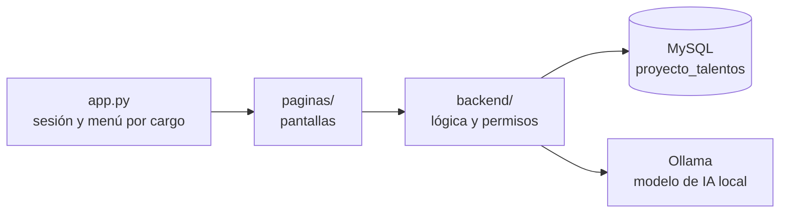
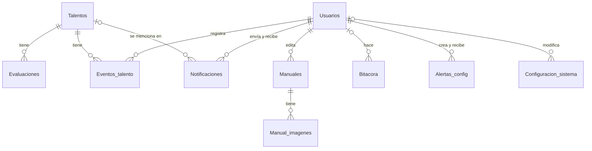

# Arquitectura de TalentOS

Cómo está construido el sistema por dentro: sus capas, el modelo de datos y el flujo de una
evaluación con IA. Para instalarlo y usarlo, ver el [README](../README.md).

## Capas

El sistema tiene tres capas. **`app.py`** es la entrada (`streamlit run app.py`): revisa la
sesión, decide qué pantallas puede ver cada cargo, dibuja el menú y, si algo falla, muestra la
pantalla de error con su código. **`paginas/`** tiene una pantalla por sección (Talentos,
Paneles, Reportes...); solo dibuja la interfaz y llama al backend. **`backend/`** tiene la
lógica: conexión a MySQL (`db.py`), permisos por cargo (`permisos.py`), IA (`ia.py`),
evaluaciones (`evaluaciones.py`), alertas, reportes, bitácora, etc. Las pantallas nunca
consultan la base de datos directamente.

## Modelo de datos

Las 10 tablas de `database/crear_bd.sql`:

| Tabla | Qué guarda | Con qué se relaciona |
|---|---|---|
| `Usuarios` | Las cuentas del sistema: cargo (Administrador RH o Encargado de área), área, datos de contacto, contraseña (PBKDF2 con su salt), bloqueo por intentos fallidos y foto | Es la tabla a la que apuntan casi todas las demás (quién registró, editó, envió o recibió algo) |
| `Talentos` | Los colaboradores evaluados: área, datos de contacto, desempeño previo (0 a 100), los textos de cada criterio (competencias, capacitación, experiencia, objetivos, liderazgo), baja lógica y foto | No depende de otra tabla; de ella dependen `Evaluaciones`, `Eventos_talento` y `Notificaciones` |
| `Evaluaciones` | Cada evaluación con IA: nivel de cada criterio, nivel de potencial, puntuación (0 a 100), reporte y clasificación 9-box | Pertenece a un talento (si se borra el talento, se borran sus evaluaciones) |
| `Eventos_talento` | La línea de tiempo del talento: ingreso, promociones, capacitaciones, cambios de área o desempeño, evaluaciones con IA y cambios de clasificación | Pertenece a un talento (se borra con él) y guarda el usuario que lo registró |
| `Manuales` | Los manuales de cada sección, uno por cargo (`dirigido_a`), con su texto y enlace | Guarda el usuario que lo editó por última vez |
| `Manual_imagenes` | Las imágenes de cada manual (hasta 10, PNG o JPG de hasta 5 MB) con su número de orden | Pertenece a un manual (se borran con él) |
| `Notificaciones` | Los mensajes dentro del sistema: solicitudes de corrección o reevaluación, alertas automáticas, solicitudes de restablecer acceso; su estado (pendiente o revisado) y la respuesta | Tiene un emisor y un destinatario en `Usuarios` (el emisor queda vacío si la envía el sistema) y puede mencionar a un talento (si se borra el talento, la notificación se conserva sin el vínculo) |
| `Bitacora` | El registro de acciones: inicios y cierres de sesión, intentos fallidos, altas, ediciones, bajas, evaluaciones con IA (con sus intentos), exportaciones y cambios de configuración | Guarda el usuario que hizo la acción; la tabla y el registro afectados se anotan como texto y número, sin llave foránea, para que la bitácora sobreviva al borrado. El usuario de MySQL de la aplicación solo puede leerla y agregarle filas |
| `Alertas_config` | Las reglas de alerta: indicador (puntuación, nivel de potencial, desempeño previo o días sin evaluar), condición, umbral, área y grado de emergencia | Tiene un creador y un destinatario en `Usuarios`; cuando se cumple, crea una fila en `Notificaciones` |
| `Configuracion_sistema` | Los parámetros que se cambian en **Parámetros del sistema**: tiempo máximo de la IA, evaluaciones por día, bloqueo de cuentas, inactividad de la sesión y contacto de soporte | Guarda el usuario que modificó cada parámetro |

## Flujo de una evaluación con IA

Desde que el Administrador pulsa **Evaluar con IA** hasta que se guarda la clasificación 9-box:

1. **`paginas/talentos.py` · `evaluacion_ia(talento)`**: en la pestaña **Evaluación con IA**,
   muestra los intentos disponibles del día (`evaluaciones.estado`). Al pulsar **Evaluar con
   IA** llama a `evaluaciones.evaluar(usuario, id_talento)`. El botón solo aparece para el
   Administrador y se desactiva si ya no quedan intentos.
2. **`backend/evaluaciones.py` · `evaluar(administrador, id_talento)`**: comprueba el permiso
   (`permisos.exigir(..., "evaluar_ia")`), lee de `Talentos` los datos del talento y de
   `Configuracion_sistema` el tiempo máximo y las evaluaciones por día, y cuenta los intentos ya
   usados hoy en la `Bitacora` (`_intentos_usados`). Si no quedan, lanza **E-104**.
3. **`backend/ia.py` · `asegurar_carga()`**: si el modelo no está en memoria, lo carga antes de
   evaluar, para que la carga no consuma el tiempo máximo ni un intento (al iniciar sesión,
   `ia.precargar()` ya lo carga en segundo plano). Si Ollama no responde, **E-101**.
4. **`construir_prompt(talento, reintento)`**: arma el prompt con las instrucciones, las 9
   llaves del JSON que debe devolver y el perfil del talento: nombre, desempeño previo y los
   textos de cada criterio. Nunca envía el correo ni el teléfono. En un reintento agrega una
   indicación para que respete el formato.
5. **`pedir_evaluacion(prompt, segundos)`**: llama a Ollama con el modelo de `OLLAMA_MODEL`,
   un esquema JSON que obliga a respetar la estructura, temperatura 0.2 y el tiempo máximo.
   Cada llamada gasta un intento.
6. **`validar_respuesta(texto)`**: revisa que sea JSON con exactamente las 9 llaves, que cada
   criterio y el potencial sean `bajo`, `medio` o `alto`, que la puntuación sea un entero de 0
   a 100 y que caiga en el rango de su nivel (**`nivel_de_puntuacion(puntuacion)`**: bajo 0 a
   30, medio 31 a 70, alto 71 a 100), y que haya reporte (si pasa de 1200 caracteres, se recorta
   en la última oración completa). Si no es válida, vuelve al paso 4 con `reintento=True`
   mientras queden intentos.
7. **`backend/evaluaciones.py` · `clasificar_9box(desempeno_previo, potencial)`**: cruza el
   nivel de potencial que dio la IA con el nivel del desempeño previo registrado del talento
   (el número de 0 a 100, convertido con `nivel_de_puntuacion`) en la matriz 9-box; por
   ejemplo, potencial alto y desempeño medio es «Futuro líder». Sin desempeño previo queda
   «Sin clasificar».
8. **Guardado**, en una sola transacción: la fila nueva en `Evaluaciones`, el evento
   `evaluacion_ia` en `Eventos_talento` (y `cambio_clasificacion` si cambió el nivel de
   potencial), las alertas de variación (`alertas.al_evaluar`, que compara con la evaluación
   anterior y crea las `Notificaciones`) y el registro en `Bitacora` con el número de intentos.
   La pantalla muestra el resultado.

### Si algo falla

| Código | Cuándo | Qué hace el sistema |
|---|---|---|
| E-101 | Ollama no responde o el modelo no está descargado (pasos 3 y 5) | No gasta el intento. Muestra la pantalla de error de `app.py`; el resto del sistema sigue funcionando |
| E-102 | El modelo pasa del tiempo máximo (paso 5) | Gasta el intento y se detiene sin reintentar |
| E-103 | Ninguna respuesta fue válida en los intentos disponibles (paso 6) | Cada rechazo se anota en `logs/sistema.log` con su motivo |
| E-104 | El talento ya usó sus evaluaciones del día (paso 2) | No llama al modelo. Los intentos se renuevan cada día o al editar los datos del talento |

Las evaluaciones fallidas no se guardan en `Evaluaciones`, pero sus intentos sí quedan en la
`Bitacora` (con el código y los motivos de rechazo) para contarlos en el límite diario. Los
errores E-101 y E-102 también se escriben en `logs/sistema.log`.
